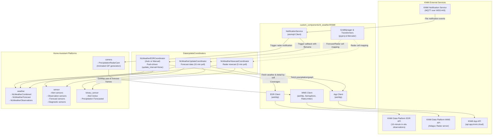

# AGENTS.md — Developer & AI Agent Guide for `ha-nl-weather`

This document serves as the architectural overview, development reference, and operational handbook for human developers and autonomous AI agents working in this repository.

---

## 1. Project Overview & Mission

[`ha-nl-weather`](https://github.com/PaulVanSchayck/ha-nl-weather) is a custom [Home Assistant](https://www.home-assistant.io/) integration (domain: `nl_weather`) designed to provide Dutch weather data sourced directly from the official **KNMI** (Koninklijk Nederlands Meteorologisch Instituut — Royal Netherlands Meteorological Institute).

### Core Capabilities
- **Combined Weather Entity**: Merges live meteorological observations with official KNMI forecasts into a single primary `weather` entity, with dedicated observation-only and forecast-only entities also available.
- **Minute-Precision Precipitation Nowcast**: Provides 2-hour forward-looking precipitation prediction (with minute-by-minute resolution via entity service and 5-minute raw intervals via sensor attributes).
- **Animated Precipitation Radar**: Custom camera entity generating animated GIF loops by compositing KNMI WMS radar frames with customizable background themes (light/dark) and home location markers.
- **Official KNMI Weather Alerts**: Alert level tracking (green/none, yellow, orange, red) and description extraction per Dutch alert region.
- **Flexible Station Selection**:
  1. **Automatic Mode**: Computes the nearest weather station on a per-measurement basis, aggregating available sensor readings from multiple nearby stations.
  2. **Manual Mode**: Locks to a specific KNMI station selected by the user.
- **Event-Driven Push Architecture (`cloud_push`)**: Subscribes to KNMI's MQTT Notification Service to reactively fetch updated observation netCDF coverages and radar files without aggressive polling.

---

## 2. System Architecture & Data Flow

### High-Level Architectural Flow



---

## 3. Directory Layout & Module Responsibilities

```
ha-nl-weather/
├── .github/
│   ├── dependabot.yml           # Automated dependency updates
│   └── workflows/
│       ├── check-version.yml     # Verifies git tag matches manifest.json version
│       ├── lint.yml              # CI lint and format check with ruff
│       └── validate.yml          # Hassfest and HACS compliance validation
├── .pre-commit-config.yaml      # Pre-commit hooks (ruff-check, ruff-format, hooks)
├── hacs.json                    # HACS integration metadata
├── requirements.txt             # Development requirements (homeassistant, aiomqtt, ruff)
├── tests/
│   └── test_osm.py              # Unit tests for OSM rendering, zoom math & projections
├── custom_components/
│   └── nl_weather/
│       ├── __init__.py           # Integration lifecycle (setup, unload, migrations, background tasks)
│       ├── const.py              # Constants, condition code mappings, styles, enums
│       ├── coordinator.py        # DataUpdateCoordinators (EDR Auto/Manual, App Forecast, Nowcast)
│       ├── config_flow.py        # Config flow (API tokens), subentries (locations), options flow
│       ├── weather.py            # Weather platform (combined, forecast, observation entities + service)
│       ├── sensor.py             # Sensor platform (measurements, alerts, diagnostics)
│       ├── binary_sensor.py      # Binary sensor platform (alert active, precipitation incoming)
│       ├── camera.py             # Camera platform (animated GIF precipitation radar)
│       ├── services.yaml         # Service registration schema (get_minute_forecast)
│       ├── manifest.json         # Integration manifest (iot_class: cloud_push, requirements)
│       ├── background_dark.png   # Radar base map (dark theme)
│       ├── background_light.png  # Radar base map (light theme)
│       ├── translations/
│       │   ├── en.json           # English UI strings & options
│       │   └── nl.json           # Dutch UI strings & options
│       └── KNMI/
│           ├── __init__.py       # Package init
│           ├── app.py            # KNMI App API client (api.app.knmi.cloud)
│           ├── edr.py            # KNMI EDR client (api.dataplatform.knmi.nl/edr/v1)
│           ├── wms.py            # KNMI WMS client (api.dataplatform.knmi.nl/wms/adaguc-server)
│           ├── notification_service.py # MQTT client for KNMI push notifications
│           ├── grid_definitions.py     # KNMI spatial grid projections & cell calculation
│           ├── helpers.py        # Geo math (Haversine distance, Mercator projection, ISO formatting)
│           └── osm.py            # OpenStreetMap tile downloading, caching, zone weighting & auto-zoom
```

---

## 4. Key Components & Implementation Details

### 4.1. Entry Management & Subentries Pattern
- **Parent `ConfigEntry`**: Configures global KNMI API credentials:
  - `CONF_EDR_API_TOKEN`
  - `CONF_WMS_TOKEN`
  - `CONF_MQTT_TOKEN`
- **Subentries (`ConfigSubentry`)**: Introduced to support multiple weather locations cleanly under a single integration instance:
  - Subentry key: `"location"` (`LocationSubentryFlowHandler`).
  - Stores location coordinates (`CONF_LATITUDE`, `CONF_LONGITUDE`), friendly name (`CONF_NAME`), alert region (`CONF_REGION`), and observation mode (`CONF_MODE`: `auto` or `manual`).
  - In manual mode, stores the chosen KNMI weather station (`CONF_STATION`).
- **Options Flow (`OptionsFlowHandler`)**:
  - Global options:
    - `map_provider`: `static` (default) or `osm` (OpenStreetMap).
    - `radar_style`: `light` or `dark`.
    - `map_style`: `minimalist` (OpenMapTiles / Positron & Dark Matter) or `standard` (OSM).
    - `mark_locations`: boolean (default True).
    - `zoom_level`: `auto` (fits all known zones with 50% margin) or fixed integer levels `6` through `14`.
    - `center_mode`: `auto` (weighted center of all known zones) or `custom`.
    - `center_latitude` / `center_longitude`: optional custom center coordinates.
- **Migration Logic (`async_migrate_entry`)**:
  - Automatically migrates config version `1.1` to `1.2` by ensuring subentries default to `StationMode.AUTO`.

### 4.2. KNMI API Clients ([`custom_components/nl_weather/KNMI/`](file:///home/tehkode/dev/ha-nl-weather/custom_components/nl_weather/KNMI))

1. **EDR Client ([`edr.py`](file:///home/tehkode/dev/ha-nl-weather/custom_components/nl_weather/KNMI/edr.py))**:
   - Interfaces with OGC EDR endpoint: `10-minute-in-situ-meteorological-observations`.
   - Fetches station cube coverages for the past half hour (`past_half_hour()`) using bounding box `BBOX_NL = "-68.5,12.0,7.4,55.7"`.
   - Fetches individual station coverages for manual station mode.

2. **WMS Client ([`wms.py`](file:///home/tehkode/dev/ha-nl-weather/custom_components/nl_weather/KNMI/wms.py))**:
   - Queries Adaguc server for real-time (`nl_rdr_data_rtcor_5m`) and forecast (`radar_forecast`) precipitation radar images in EPSG:3857 projection.
   - Enforces concurrency and rate limits: `asyncio.Semaphore(1)`, `asyncio.Lock()`, rate-limited to 15 requests/sec.
   - Important: Requests format timestamps with Zulu `Z` (e.g. `2026-10-29T05:00:00Z`) rather than `+00:00` offset to maintain CDN / Adaguc cache hits.

3. **Notification Service ([`notification_service.py`](file:///home/tehkode/dev/ha-nl-weather/custom_components/nl_weather/KNMI/notification_service.py))**:
   - Connects to `mqtt.dataplatform.knmi.nl` via MQTT v5 over WebSockets (`port=443`, `transport="websockets"`, TLS enabled).
   - Subscribes to:
     - `dataplatform/file/v1/10-minute-in-situ-meteorological-observations/1.0/#`
     - `dataplatform/file/v1/radar_forecast/2.0/#`
   - Dispatches incoming dataset events asynchronously to registered callbacks.

4. **App API Client ([`app.py`](file:///home/tehkode/dev/ha-nl-weather/custom_components/nl_weather/KNMI/app.py))**:
   - Talks to `https://api.app.knmi.cloud`.
   - `weather(cell_id, region)`: General daily & hourly forecast summary.
   - `weather_detail(cell_id, region, date)`: Enriches daily forecast with precipitation probability, UV index, and heat force index (`heatIndex`).
   - `precipitation_graph(radar_cell_id, date)`: 5-minute interval precipitation nowcast values.

5. **Grid Math & Spatial Projections ([`grid_definitions.py`](file:///home/tehkode/dev/ha-nl-weather/custom_components/nl_weather/KNMI/grid_definitions.py), [`helpers.py`](file:///home/tehkode/dev/ha-nl-weather/custom_components/nl_weather/KNMI/helpers.py))**:
   - Calculates forecast cell IDs (`A<num>`) using WGS84 bounding coordinates.
   - Calculates radar cell IDs (`B<num>`) using stereographic projection (`+proj=stere +lat_0=90 +lon_0=0 +lat_ts=60 +a=6378.14 +b=6356.75 +x_0=0 y_0=0`).
   - Converts geographic coordinates to Web Mercator (`epsg4325_to_epsg3857`) for radar overlay pixel positioning.
   - Computes Haversine distance in kilometers to sort weather stations by distance.

### 4.3. Data Coordinators ([`coordinator.py`](file:///home/tehkode/dev/ha-nl-weather/custom_components/nl_weather/coordinator.py))

| Coordinator | Polling Interval | Source | Responsibility |
|---|---|---|---|
| `NLWeatherUpdateCoordinator` | 15 minutes | App API (`weather` & `weather_detail`) | Hourly/daily forecasts, alert levels, UV index, heat force index. |
| `NLWeatherNowcastCoordinator` | 5 minutes | App API (`precipitation/graph`) | 5-minute resolution precipitation nowcast array. |
| `NLWeatherAutoEDRCoordinator` | None (push-driven) | EDR API via MQTT events | Sorts all station coverages by distance; picks closest non-null value per weather parameter. |
| `NLWeatherManualEDRCoordinator` | None (push-driven) | EDR API via MQTT events | Fetches coverage for the user's explicitly selected station. |

*Note on EDR timing*: When an MQTT file notification arrives, the coordinator waits `15 + randint(0, 10)` seconds before querying EDR to guarantee the file is fully ingested and indexed on KNMI's backend.

### 4.4. Home Assistant Entity Platforms

- **Weather Platform ([`weather.py`](file:///home/tehkode/dev/ha-nl-weather/custom_components/nl_weather/weather.py))**:
  - `NLWeatherCombined`: Default primary entity. Prioritizes observation sensors for current weather; falls back to forecast values.
  - `NLWeatherObservations`: Observation-only weather entity (disabled by default in registry).
  - `NLWeatherForecast`: Forecast-only weather entity (disabled by default in registry).
  - Custom Entity Service: `get_minute_forecast` (returns interpolated minute-by-minute rainfall predictions for 2 hours forward).
- **Sensor Platform ([`sensor.py`](file:///home/tehkode/dev/ha-nl-weather/custom_components/nl_weather/sensor.py))**:
  - Alert sensors: `alert` (description), `alert_count`, `alert_level` (enum: none, yellow, orange, red).
  - Observation sensors: Air temperature (1.5m), grass/ground temperature (10cm), soil temperature (-10cm), relative humidity, dew point, pressure, wind speed, wind gust, wind bearing (degrees & cardinal), visibility, cloud coverage (oktas converted to percentage), cloud ceiling (feet), sunshine duration, solar radiation ($W/m^2$).
  - Forecast sensors: Today's and tomorrow's min/max temperatures, current and daily maximum heat force index (`hittekracht`).
  - Diagnostic sensors: Station name (comma-separated if blended in auto mode), station distance, observation timestamp, alert region.
- **Binary Sensor Platform ([`binary_sensor.py`](file:///home/tehkode/dev/ha-nl-weather/custom_components/nl_weather/binary_sensor.py))**:
  - `NLWeatherAlertActiveSensor`: Active when KNMI alert level is yellow, orange, or red.
  - `NLWeatherPrecipitationNowcastSensor`: Active when precipitation $> 0$ in the upcoming 2-hour window. Exposes full 5-minute forecast list in `forecast` extra state attribute.
- **Camera Platform ([`camera.py`](file:///home/tehkode/dev/ha-nl-weather/custom_components/nl_weather/camera.py))**:
  - `PrecipitationRadarCam`: Assembles an animated GIF with:
    - 7 frames of past 60 minutes real-time radar (`nl_rdr_data_rtcor_5m`).
    - 13 frames of forward 120 minutes forecast radar (`radar_forecast`).
    - Dynamic BBOX querying: Passes exact EPSG:3857 bounding box matching the configured map view to KNMI Adaguc WMS.
    - Base map support:
      1. **Static map** (default): Bundled base maps ([`background_light.png`](file:///home/tehkode/dev/ha-nl-weather/custom_components/nl_weather/background_light.png) or [`background_dark.png`](file:///home/tehkode/dev/ha-nl-weather/custom_components/nl_weather/background_dark.png)).
      2. **OpenStreetMap / OpenMapTiles**: Dynamic tile stitching and disk caching in `.storage/ha_nl_weather/`, with auto-zoom covering all known zones with 50% margin and radius-weighted centroid centering.
    - Rendered location marker circles and timestamp overlays.
    - Synchronized via `asyncio.Condition` so concurrent camera requests share a single generation process.

---

## 5. Development Environment & Tooling

### Prerequisites
- Python 3.13 or Python 3.14
- [`uv`](https://github.com/astral-sh/uv) (recommended for rapid virtualenv management and ephemeral tool execution)
- Git

### Installing Dependencies
```bash
# Using standard virtualenv
python3 -m venv .venv
source .venv/bin/activate
pip install -r requirements.txt

# Or using uv
uv venv
source .venv/bin/activate
uv pip install -r requirements.txt
```

### Code Formatting & Linting
The project strictly enforces **Ruff** (pinned to version `0.16.7` in CI and `.pre-commit-config.yaml`):

```bash
# Check lint rules
uvx --from ruff==0.16.7 ruff check .

# Check formatting
uvx --from ruff==0.16.7 ruff format . --check

# Auto-fix lint issues and format files
uvx --from ruff==0.16.7 ruff check . --fix
uvx --from ruff==0.16.7 ruff format .
```

### Automated Tests
Run unit tests with pytest:
```bash
PYTHONPATH=. uvx --with pillow --with aiohttp --with pyproj --with homeassistant --with aiomqtt pytest tests/
```

### Pre-commit Hooks
Pre-commit is configured to run ruff check, ruff format, JSON syntax checks, and prevent accidental direct commits to `main`, `dev`, or `rc`:
```bash
uvx pre-commit run --all-files
```

### CI Workflows Overview
- **`lint.yml`**: Runs `ruff check .` and `ruff format . --check` against Python 3.13.
- **`validate.yml`**: Runs Home Assistant's official `hassfest` action and `hacs/action` validation.
- **`check-version.yml`**: Triggers on version tags (`v*`) and ensures git release tag matches `"version"` in [`manifest.json`](file:///home/tehkode/dev/ha-nl-weather/custom_components/nl_weather/manifest.json).

---

## 6. Coding Standards & Guidelines for AI Agents

When editing or generating code in this repository, adhere strictly to these principles:

### 1. Home Assistant Async Conventions
- **Never perform blocking I/O on the event loop**:
  - Use `async_get_clientsession(hass)` for HTTP requests.
  - Image manipulation with Pillow (opening files, composite, saving GIFs) must be offloaded using `await hass.async_add_executor_job(...)` if not running inside dedicated worker tasks.
  - Long-running loops (like MQTT listening) must be attached via `entry.async_create_background_task(hass, ...)`.
- **Subentries Management**:
  - Always iterate or access subentries via `entry.subentries` and `subentry.subentry_id`.
  - Pass `config_subentry_id=subentry_id` when registering entities via `async_add_entities()`.

### 2. Timezone & Datetime Serialization
- All datetimes communicated to KNMI WMS or EDR must be UTC.
- Always format datetimes using [`format_dt(dt)`](file:///home/tehkode/dev/ha-nl-weather/custom_components/nl_weather/KNMI/helpers.py#L96):
  ```python
  def format_dt(dt: datetime) -> str:
      return dt.isoformat(timespec="seconds").replace("+00:00", "Z")
  ```
  *Warning*: KNMI Adaguc server uses the literal `Z` in cache keys; using `+00:00` ruins cache hit ratios and can trigger 400 Bad Request.

### 3. Rate Limiting & Concurrency
- Respect KNMI WMS rate limits (max 15 requests/second). Do not bypass the semaphore or lock in [`custom_components/nl_weather/KNMI/wms.py`](file:///home/tehkode/dev/ha-nl-weather/custom_components/nl_weather/KNMI/wms.py).
- When reacting to MQTT notifications (`radar_forecast` or `10-minute-in-situ-meteorological-observations`), always keep the 15-second + random jitter sleep delay. Querying immediately after an MQTT broadcast often yields 404 Not Found because remote files are still replicating.

### 4. Code Style & Typing
- Maintain modern Python type annotations (`from __future__ import annotations`, `dict[str, Any]`, `type Alias = ...`).
- Preserve existing comments and docstrings unless directly modified.
- Avoid introducing external runtime dependencies unless added to both [`requirements.txt`](file:///home/tehkode/dev/ha-nl-weather/requirements.txt) and [`manifest.json`](file:///home/tehkode/dev/ha-nl-weather/custom_components/nl_weather/manifest.json).

---

## 7. Common Pitfalls & Edge Cases

1. **Weather Station Differences**:
   - Airport stations (e.g., Schiphol / 06240) report almost all parameters (cloud ceiling, visibility, grass temp).
   - Marine/buoy stations or automated wind masts only report basic wind/temperature data.
   - In `NLWeatherAutoEDRCoordinator`, code assumes some parameters may be missing or `None` in the nearest station; it continues searching through stations sorted by distance until a valid reading is found.
2. **Precipitation Unit Conversions**:
   - In EDR observations, wind speed is $m/s$.
   - In App API forecasts, wind speed is $km/h$.
   - When merging observations into the combined weather entity (`NLWeatherCombined`), observation wind speeds are converted: `wind_speed * 3.6`.
3. **Cloud Coverage Scale**:
   - KNMI reports cloud coverage in oktas ($0 - 8$, with $9 = \text{sky obscured}$).
   - Converted to percentage in [`sensor.py`](file:///home/tehkode/dev/ha-nl-weather/custom_components/nl_weather/sensor.py#L129-L136) ($9 \to 100\%$, otherwise $\text{round}(\text{okta} / 8 \times 100, 1)$).
4. **Service Schema Hack in `services.yaml`**:
   - [`services.yaml`](file:///home/tehkode/dev/ha-nl-weather/custom_components/nl_weather/services.yaml) references `climate.ClimateEntityFeature.SWING_MODE` as a workaround for Home Assistant entity feature validation when registering custom feature flags (`NLWeatherEntityFeature.FORECAST_MINUTE`). Keep this in mind when touching entity services.

---

## 8. Pull Request & Verification Checklist

Before submitting changes or completing an agent task:
- [ ] Run `uvx --from ruff==0.16.7 ruff check .` and fix all violations.
- [ ] Run `uvx --from ruff==0.16.7 ruff format . --check` to verify code format.
- [ ] If changing config flow schemas or strings, update both [`en.json`](file:///home/tehkode/dev/ha-nl-weather/custom_components/nl_weather/translations/en.json) and [`nl.json`](file:///home/tehkode/dev/ha-nl-weather/custom_components/nl_weather/translations/nl.json).
- [ ] If releasing a new version, update `version` in [`manifest.json`](file:///home/tehkode/dev/ha-nl-weather/custom_components/nl_weather/manifest.json) to match the planned git tag.
- [ ] Ensure all entity unique IDs remain deterministic and backward compatible (e.g. `{config_entry.entry_id}_{subentry.subentry_id}_{key}`).
